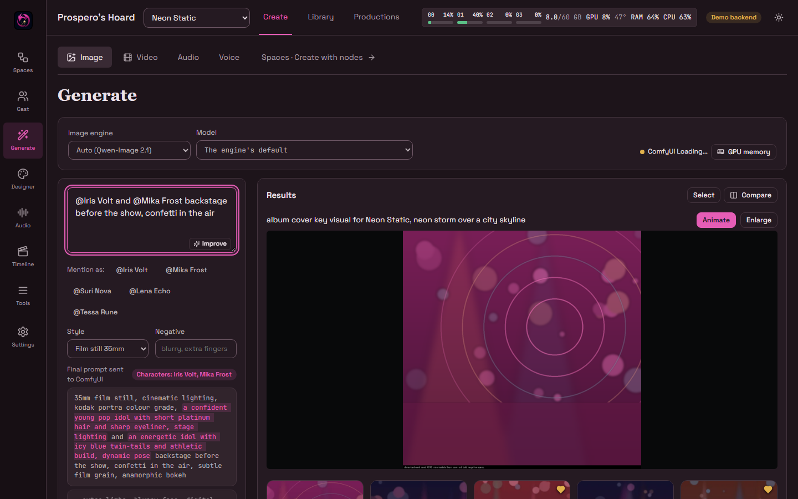
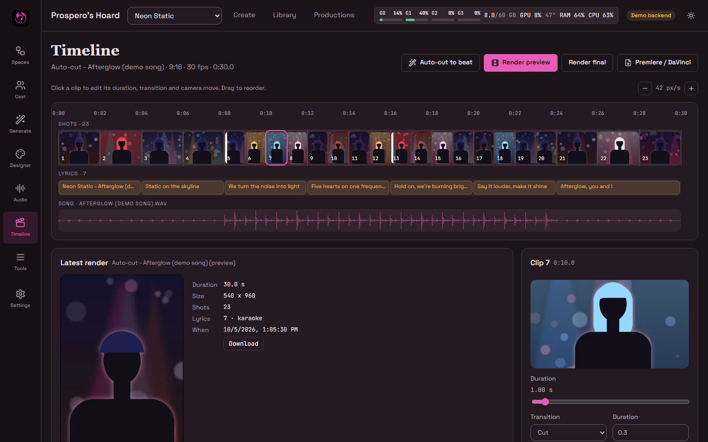
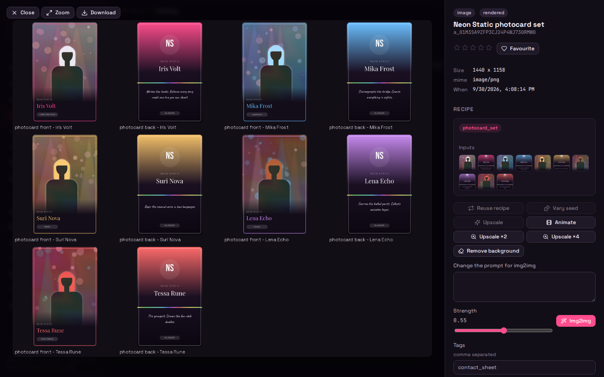
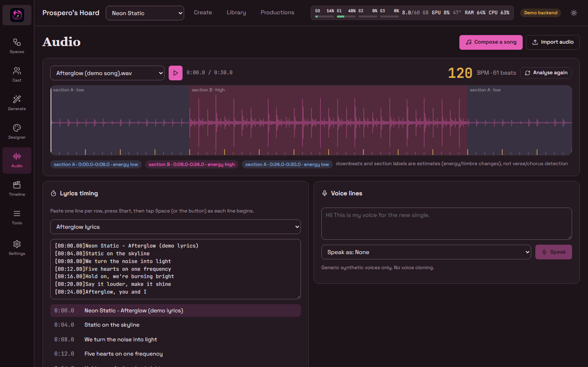
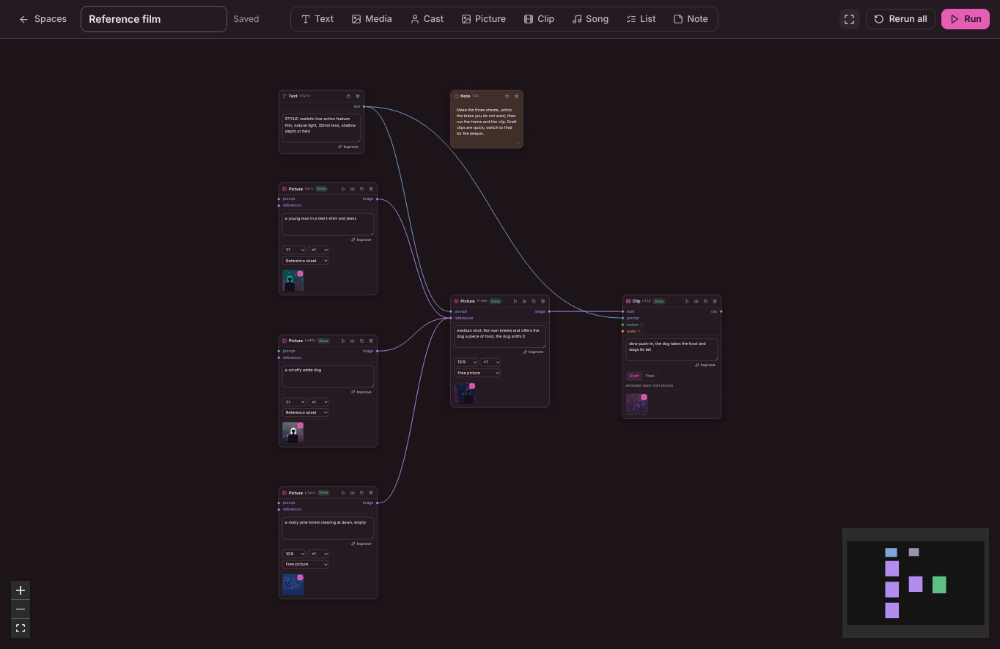
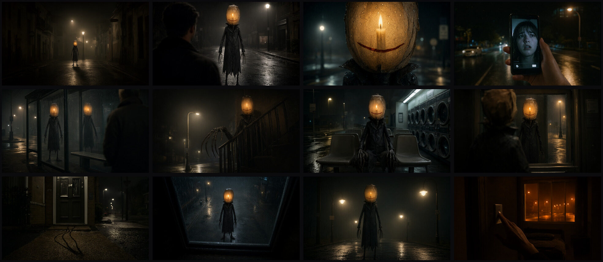
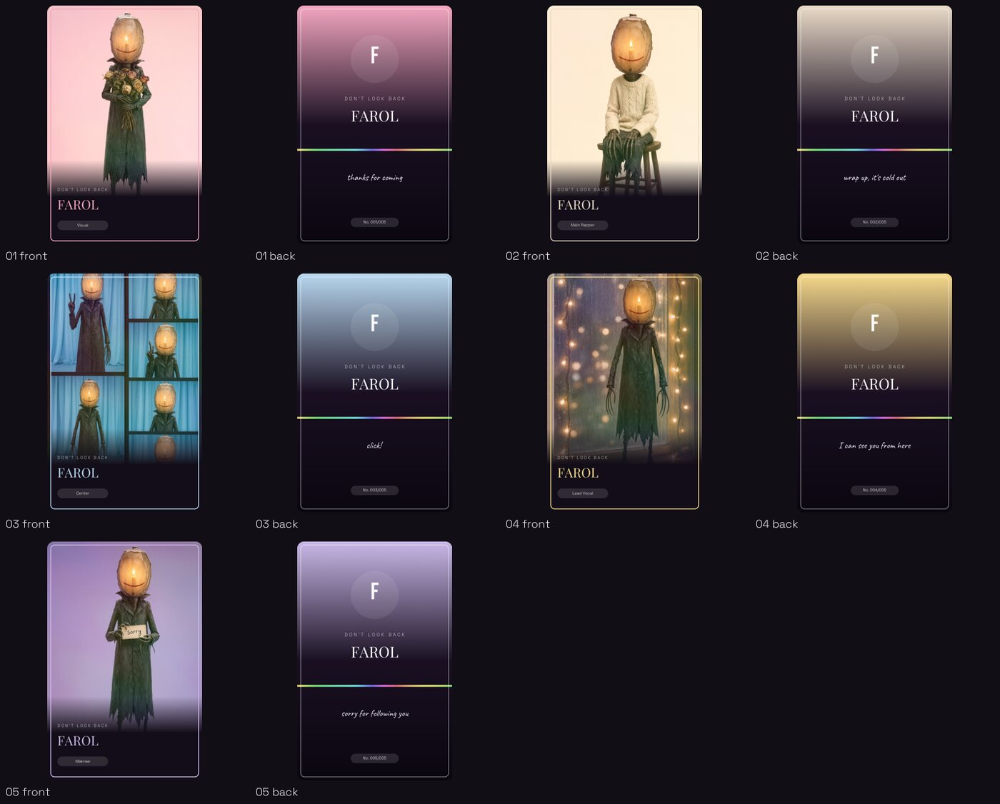
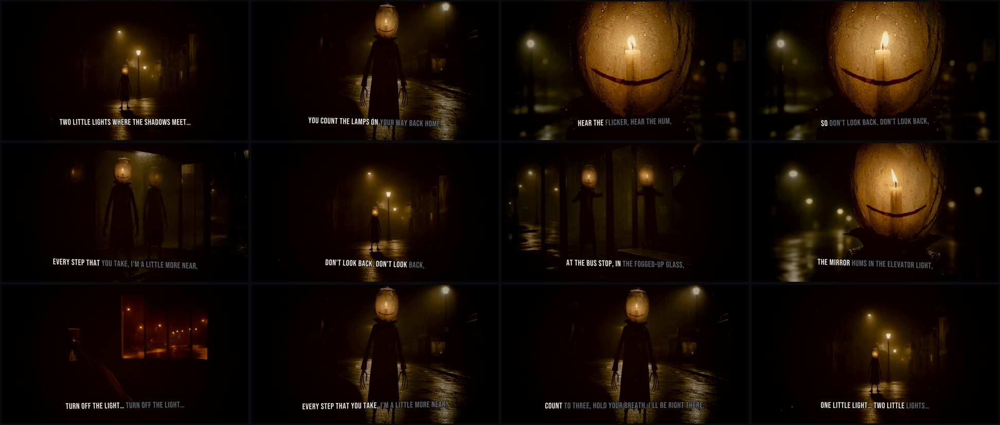

# Prospero's Hoard

Un estudio de medios local que maneja tu ComfyUI, ffmpeg y un motor de voz local para crear personajes coherentes, photocards, portadas, videoclips y cortos narrados, a mano o enteramente por MCP.

[English](README.md) · [Inicio rápido](#inicio-rápido) · [Conectarlo a Faustus](#conectarlo-a-faustus) · [Referencia MCP](docs/MCP.md) · [Estudio de voz](docs/VOICE.md)


*Aplicación real, datos de demostración sintéticos. Todas las imágenes salen del backend de demostración incluido, un sustituto procedural de ComfyUI que dibuja escenas con etiquetas; con tu ComfyUI conectado las mismas pantallas muestran resultados reales del modelo.*

## Qué es

Un modelo de lenguaje al que se le pide ayuda con una producción musical pequeña (un grupo inventado, sus photocards, una portada, un vídeo para el single) solo puede describir lo que haría. No puede ejecutar un grafo de nodos, mantener la cara de un personaje en cuarenta imágenes, encontrar el pulso de una canción ni contestar después «¿qué semilla y qué checkpoint hicieron esta carta?».

Prospero convierte cada paso en una operación tipada y encolable con una receta registrada. Los personajes se mencionan como `@Nombre` y su descripción se incluye siempre, cada recurso conserva los parámetros exactos que lo hicieron, las canciones se analizan (tempo y secciones) y una línea de tiempo se corta al compás y se renderiza con ffmpeg. El modelo local dirige; el estudio hace el trabajo y responde con ids e imágenes.

Es una app FastAPI con interfaz React, almacén SQLite y workers de GPU y CPU. No aloja ningún modelo: los backends de imagen, vídeo, música y voz se encuentran con el resolvedor compartido de la familia (ComfyUI, Faustus TTS, Piper). Además es un plugin de [Faustus](https://github.com/Luissalet/Faustus), con un adaptador MCP que expone todo el estudio a un agente.

Usos típicos:

- Una música independiente importa un single terminado, deja que el detector de pulso encuentre tempo y secciones, sincroniza la letra y obtiene una portada, una tarjeta de letra y un vídeo 9:16 cortado al compás.
- Un escritor o diseñador de juegos da a cada personaje un prompt de aspecto y una referencia canónica, pide «@Iris y @Mika entre bastidores» y obtiene las mismas caras en decenas de imágenes.
- Un modelo local en Faustus al que se pide «un teaser del single» llama a las herramientas del estudio, recibe ids cortos y solo mira una imagen cuando la pide.
- Quien explica cosas escribe un tema y obtiene un corto vertical narrado: guion, voz en off, subtítulos palabra a palabra, imágenes de archivo o generadas y música que baja bajo la voz.
- Un usuario de ComfyUI importa su flujo en formato UI, lo ve convertido y comprobado contra la lista de nodos en vivo, y genera con él desde entonces con linaje.

## Qué hace

**Proyectos y reparto**
- Proyectos, personajes (prompt de aspecto, negativo, paleta, referencia canónica, voz), lugares y objetos, grupos ordenados y estilos predefinidos.
- Las menciones `@Nombre` reconocen nombres de varias palabras y avisan de los desconocidos; un lugar u objeto mencionado con imagen entra en el render como referencia numerada en Qwen-Image 2.1.
- Kit de personaje: hoja de modelo redibujada desde hasta 12 vistas, dataset con pies de foto e informe de preparación, entrenamiento local de LoRA con un entrenador configurable, tomas con puntuación de identidad, paquetes `.hoardchar` portables y biblioteca global de reparto con versiones.

**Imágenes**
- Motores: Qwen-Image 2.1 (txt2img y edición multirreferencia de 1 a 10 referencias), FLUX.1 schnell, ediciones FLUX.1 Kontext, SDXL (img2img, inpaint, hires fix en dos pasadas) y SD 1.5. `auto` elige el mejor motor instalado y cada resultado dice cuál usó.
- Ampliación con modelo (x2 o x4), eliminación de fondo a PNG transparente, mapas de pose y profundidad, outpainting sobre un lienzo mayor, y reencuadre de cualquier imagen o clip a 9:16, 16:9, 1:1, 4:5, 2:3, 3:2 o 21:9 sin regenerar.
- Importación de tus flujos de ComfyUI con comprobación previa: se verifican clases de nodo y archivos de modelo, y los que faltan se listan con su carpeta.

**Vídeo**
- Imagen a vídeo con Wan 2.2 (TI2V 5B, I2V 14B), SVD y LTX 2.3 (con refinado 2x opcional y control de estructura); transferencia de movimiento, sincronía labial (voz y canto largo) y clips de primer a último fotograma.
- Rehacer un tramo de un clip (Wan VACE), editar un clip entero desde una instrucción, suavizar clips a más fps y revisar el movimiento con comprobaciones técnicas y un modelo de visión opcional.
- Lienzos de nodos (Spaces) con conexiones tipadas y coloreadas para imágenes, clips, canciones, reparto, capas y asistentes, con deshacer y biblioteca de nodos acoplada.
- Planos gráficos dibujados por código (rótulo de título, letra cinética, tercio inferior, cierre), escenas Manim, animaciones HTML exportadas a H.264 con sonido generado, películas QR, vídeos promocionales de una página web y grabaciones de recorrido de un sitio.
- Vídeos explicativos con escenas, narración y diagramas importados; composición de imagen con cajas de objetos y texto.

**Audio y voz**
- Importación de mp3, wav, flac, ogg y m4a, forma de onda, detector de pulso propio con estimación de tiempos fuertes y secciones, letras LRC con herramientas de sincronización y separación de pistas (voz, batería, bajo, otros, instrumental).
- Composición de canciones con ACE-Step 1.5 en ComfyUI, o con otro servidor local mediante una pequeña API HTTP.
- Estudio de voz con registro de motores (Piper, Coqui XTTS-v2, F5-TTS, Kokoro, Chatterbox, KittenTTS, VoxCPM2, Yovoice, un flujo TTS de ComfyUI), clonado de voz desde una muestra tuya, voz a texto, audiolibros, doblaje con plan de tiempos y control de calidad, y repeticiones de palabras sueltas de una línea de voz. Ver [docs/VOICE.md](docs/VOICE.md).

**Diseño**
- Renderizador Pillow sin navegador: anverso y reverso de photocards, portadas (cuatro composiciones), pósters teaser, tarjetas de letra, reversos de tracklist y miniaturas, con variante nocturna, foil, degradados y texto que se ajusta; sets de photocards para un grupo entero o un solista.
- Tarjetas de estilo (aspecto, técnica, paleta, movimiento, transición de firma, trampas) con direcciones integradas e importadas.

**Producciones**
- Un videoclip entero como una producción reanudable con puntos de control: protagonista y hoja de referencia, canción, imágenes, sincronía de letra, clips, photocards, portada, el corte y sus renders, más un informe. Cambiar planos rehace solo lo que depende de ellos.
- Modo con tratamiento previo (logline, estructuras, lista de planos, hoja de pulsos) antes de renderizar nada; animatic con las imágenes cortadas como el montaje final antes de los clips caros; director de QA que revisa imágenes planas o ruidosas, bandas en los bordes, saltos de exposición, clips congelados y cobertura de la letra; biblia de continuidad con reparación de segmentos.
- Recetas: convierte una producción terminada en plantilla con un hueco `{lead}` y recréala con otro personaje.
- Cortos narrados desde un tema o un guion, con material de archivo de Pexels y Pixabay (clave de API gratuita por proveedor) importado con su crédito.

**Línea de tiempo y edición**
- Corte automático al compás en una línea de tiempo editable, renderizador ffmpeg con movimientos Ken Burns, transiciones que mantienen los cortes en el pulso, subtítulos de letra, etalonaje y efectos de acabado, y bucle para Spotify Canvas.
- Planes de edición declarativos compilados a pasos exactos de ffmpeg, la línea de tiempo como texto estable con ediciones comprobadas por revisión, y exportación al editor de vídeo como FCP7 XML y EDL (Lumiere's Hoard la abre directamente).
- Módulos nativos completos de edición de línea de tiempo y subtítulos y motores creativos, cada uno apagado hasta que lo activas. Ver [docs/STUDIO.md](docs/STUDIO.md).

**Control y seguridad**
- Linaje: cada recurso guarda plantilla, parámetros, semilla, entradas y tiempos; «Reutilizar receta» reproduce una imagen byte a byte en el mismo backend y «Variar semilla» la repite.
- Cortesía con la GPU: estimaciones de VRAM por flujo contrastadas con la tarjeta en la que corre ComfyUI, trabajos que esperan en `waiting_gpu` con el motivo, pools de render que reparten trabajos entre varias tarjetas, y una cabecera con GPU, VRAM, temperatura, RAM y CPU.
- Papelera con deshacer para los recursos borrados; pantalla Backends que muestra qué se encontró y por qué; Actividad del asistente con cada llamada de un agente.

## Modelos

No se incluye ninguno. Prospero usa lo que tengas instalado en tu ComfyUI e informa de lo que falta.

| Familia | Uso |
| --- | --- |
| Qwen-Image 2.1 (int8) | Mejor fidelidad al prompt, texto dentro de la imagen, identidad multirreferencia |
| FLUX.1 schnell / Kontext dev | Borradores rápidos / ediciones con una referencia |
| SDXL, SD 1.5 | Alternativa siempre disponible, borradores con poca VRAM |
| Wan 2.2 (TI2V 5B, I2V 14B, S2V, Animate, Fun VACE, Bernini-R), Wan 2.1 InfiniteTalk, SVD, LTX 2.3 | Imagen a vídeo, sincronía labial, transferencia de movimiento, repeticiones, edición de clips |
| ACE-Step 1.5 | Composición de canciones con voz |
| Real-ESRGAN x4, BiRefNet | Ampliación, eliminación de fondo |
| SDPose whole body, Depth Anything 3 | Mapas de pose y profundidad |

La comprobación previa de flujos indica en qué carpeta `models/<carpeta>` de ComfyUI va cada archivo, y está documentado en [docs/ARCHITECTURE.md](docs/ARCHITECTURE.md). Los modelos de vídeo pesados piden una tarjeta de 16 GB; un trabajo que no cabe espera a una que sí.

## Inicio rápido

Requisitos: Python 3.11+ (recomendado 3.13), Node.js 22 para la interfaz y ffmpeg en el PATH (si no, se usa el binario de `imageio-ffmpeg`). ComfyUI es opcional: `--demo` ejecuta todo contra un sustituto procedural.

```
git clone https://github.com/Luissalet/ProsperosHoard.git
cd ProsperosHoard
```

**Windows.** Doble clic en **`Iniciar Prospero's Hoard.cmd`** (o ejecuta `scripts\start.ps1`). La primera vez crea `.venv`, instala `requirements-lock.txt`, compila la interfaz y abre http://127.0.0.1:8815. **`Detener Prospero's Hoard.cmd`** lo para. Pasos manuales:

```powershell
C:\Python313\python.exe -m venv .venv
.venv\Scripts\python.exe -m pip install -r requirements-lock.txt
cd frontend; npm ci; npm run build; cd ..
.venv\Scripts\python.exe -m prosperos_hoard            # datos reales en .\data
.venv\Scripts\python.exe -m prosperos_hoard --demo     # datos de demo en .\data-demo
```

**Linux / macOS.**

```bash
python3 -m venv .venv
.venv/bin/python -m pip install -r requirements-lock.txt
(cd frontend && npm ci && npm run build)
.venv/bin/python -m prosperos_hoard --demo --no-browser
```

Opciones: `--port` (por defecto 8815), `--data-dir` (o `PROSPERO_DATA_DIR`), `--demo`, `--no-browser`. `PROSPERO_ALLOWED_HOSTS` permite que la API responda a un nombre de LAN o tailnet. `curl http://127.0.0.1:8815/api/health` responde `"service": "prosperos-hoard"`.

`--demo` crea un grupo inventado de cinco miembros con retratos, escenas de escenario, una portada, un set de photocards, una canción sintética de 30 s con letra sincronizada y una línea de tiempo cortada automáticamente. Para usar tu ComfyUI, déjalo en 127.0.0.1:8188 (Hoard Link lo encuentra) o indica su URL en Ajustes. `PROSPERO_COMFY_TIMEOUT_S` alarga lo que puede durar un trabajo.

## Conectarlo a Faustus

Prospero's Hoard es un plugin de [Faustus](https://github.com/Luissalet/Faustus) y se declara con [`faustus-plugin.json`](faustus-plugin.json). Arráncalo y en Faustus abre **Conectores > Apps cercanas > Añadir**: Faustus lo encuentra en el puerto 8815, lee el manifiesto y lanza el adaptador MCP (`prosperos_hoard/mcp_server.py`, stdio). El botón de Faustus dentro del estudio abre el panel de copiloto compartido para el proyecto seleccionado; Faustus gestiona la conversación y el modelo, Prospero aporta sus herramientas y su contexto. El endpoint de Faustus se configura en `data/backend.json` o con `PROSPERO_FAUSTUS_URL`.

### Herramientas MCP

Los resultados son compactos y con ids primero; las imágenes solo vienen con `include_image=true`. Los errores traen un código y el siguiente paso. Cada llamada queda auditada en **Actividad del asistente**. Argumentos y formas de resultado: [docs/MCP.md](docs/MCP.md).

| Grupo | Herramientas |
| --- | --- |
| Estado y servicios | `studio_status`, `studio_services`, `studio_service_start`, `studio_service_stop`, `studio_gpu_memory` |
| Proyectos y reparto | `studio_projects`, `studio_create_project`, `studio_project_update`, `studio_project_transfer`, `studio_modules`, `studio_cast`, `cast_import_character` |
| Imágenes | `studio_generate_image`, `studio_edit_image`, `studio_outpaint`, `studio_reframe`, `studio_prompt_enhance`, `studio_cinema` |
| Vídeo y clips | `studio_animate`, `studio_retake`, `studio_clip_edit`, `studio_interpolate`, `studio_review_clip`, `studio_spaces`, `studio_graphic_shot`, `studio_graphic_render`, `manim_*` |
| Audio y voz | `studio_compose`, `studio_analyze_audio`, `studio_stems`, `studio_voice`, `voice_*` (motores, crear, listar, hablar, transcribir, audiolibro, doblaje, repetir palabras) |
| Diseño | `studio_design`, `studio_photocard_set`, `studio_board`, `studio_style_cards` |
| Línea de tiempo y render | `studio_timeline`, `studio_render`, `studio_export_timeline`, `studio_canvas`, `studio_style_profile_*`, `studio_production_finishing`, `production_export_lumiere` |
| Producciones | `studio_production*`, `studio_video_plan`, `studio_video_from_plan`, `studio_animatic`, `studio_qa_run`, `studio_qa_report`, `studio_recipe_*`, `production_from_storyboard`, `studio_short_create`, `studio_stock_search` |
| Kit de personaje | `studio_character_sheet`, `_dataset`, `_train`, `_adapters`, `_takes`, `_pack`, `_library` |
| Vídeo web | `brand_scan`, `promo_from_url`, `contact_sheet`, `website_walkthrough`, `studio_qr_video`, `studio_qr_verify`, `studio_explainer`, `studio_spatial` |
| Recursos y trabajos | `studio_assets`, `studio_show`, `studio_lineage`, `studio_asset_update`, `studio_import`, `studio_download_media`, `studio_delete_assets`, `studio_trash`, `studio_jobs`, `studio_job`, `studio_cancel_job`, `studio_retry_job` |

Funciona con cualquier cliente MCP por stdio:

```json
{"mcpServers": {"prosperos-hoard": {
  "command": "C:/.../Prospero's Hoard/.venv/Scripts/python.exe",
  "args": ["C:/.../Prospero's Hoard/prosperos_hoard/mcp_server.py"],
  "env": {"PROSPERO_URL": "http://127.0.0.1:8815"}}}}
```

El procedimiento completo que sigue el agente está en [skills/idol-production/SKILL.md](skills/idol-production/SKILL.md). La app también lleva skills de la biblioteca de la familia para los agentes que se conectan.

### La familia Hoard

- **Contrato de agente compartido.** `GET /api/agent/tools` lista cada ruta de herramienta y `POST /api/agent/call {name, arguments}` ejecuta una con el token de portador de la familia (`data/mcp-token`). Las llamadas que cambian algo deben dar un `reason`, se escriben en `data/agent_journal.jsonl` con agente y sesión, y una sesión entera se puede deshacer con `POST /api/agent/undo` (primero en simulación).
- **Backends compartidos.** ComfyUI y la voz vienen de HoardLink; las descargas por enlace pasan por Links Hoard (yt-dlp como alternativa), y la voz a texto por Funes's Hoard cuando está disponible. Nada se carga ni se descarga a tus espaldas.
- **Eventos de trabajo y avisos.** Renders, canciones, clips y producciones emiten eventos `prospero.job.*`; las producciones que necesitan una toma, el animatic o una revisión avisan por el hub de la familia (**Ajustes > Avisos de producción**: `auto`, `hub` u `off`).
- **Cesión de GPU.** Los trabajos de GPU toman la cesión del hub para su clase de modelo además de la comprobación de VRAM (`PROSPERO_GPU_LEASE=0` la desactiva).
- **Lumiere's Hoard.** **Exportar a Lumiere** en una producción escribe el corte como XML y EDL y le pide a Lumiere que lo abra como proyecto.

## Personajes que no cambian

1. **Canónica**: una buena imagen del personaje.
2. **Hoja de modelo**: la canónica redibujada desde vistas fijas; cada vista entra en el dataset con su pie de foto.
3. **Dataset**: añade las mejores tomas, corrige los pies de foto y vigila el informe de preparación.
4. **Entrenamiento**: elige la arquitectura del motor con el que renderizas y empieza; el adaptador se instala en ComfyUI y se asocia, así que cada render con `@Nombre` lo carga.
5. **Tomas**: puntúa la identidad, conserva las buenas, rechaza las desviadas y promueve una canónica mejor.
6. **Paquete / biblioteca**: exporta un `.hoardchar` o guarda una versión en la biblioteca y úsala en cualquier proyecto o como protagonista de una receta.

El entrenamiento corre en un programa entrenador aparte, configurado en `training` de `data/backend.json` (`--demo` configura uno falso). Detalles: [docs/CHARACTERS.md](docs/CHARACTERS.md).

## Pantallas


*Aplicación real, datos de demostración sintéticos: el corte automático de la canción de demo de 30 s y la vista previa renderizada con ffmpeg.*


*Aplicación real, datos de demostración sintéticos: el set de photocards abierto en el visor con su receta y sus entradas.*


*Aplicación real, datos de demostración sintéticos: la canción de demo analizada por el detector de pulso integrado, con estimación de secciones y letra LRC sincronizada.*


*Aplicación real, datos de demostración sintéticos: un espacio donde tres hojas alimentan un fotograma mediante sus referencias y el fotograma inicia un clip borrador.*

<details>
<summary>Una producción real: un single inventado, de la portada a los cortes 9:16 y 16:9</summary>

El single de ejemplo se compuso con ACE-Step, con un protagonista coherente, y se produjo como un videoclip de doce planos con clips Wan, un set de photocards, una portada y dos cortes.


<p>

</p>








</details>

## Privacidad y seguridad

Solo local: la app escucha en 127.0.0.1, no envía telemetría y solo sale a internet cuando pides una voz de Piper aún no descargada, una descarga por enlace o material de archivo. Las peticiones con una cabecera `Host` ajena se rechazan (DNS rebinding), igual que las escrituras desde otras webs. Los agentes solo pueden importar archivos de tu carpeta personal, `data/inbox` y las carpetas que añadas en Ajustes, y solo si su contenido corresponde a su tipo; los archivos se sirven siempre por id. El clonado de voz corre en motores locales que instalas explícitamente y solo desde una muestra que aportes; usar la voz de otra persona sin su consentimiento es responsabilidad tuya. Los datos quedan en `data/` (o en tu `--data-dir`); el token de Faustus se guarda en `data/backend.json` y la API nunca lo devuelve.

## Límites conocidos

- Las comprobaciones del director de QA son heurísticas; sus puntuaciones de biblia, prompt y referencias necesitan un modelo de visión, y elegir la toma final de oído sigue siendo cosa tuya.
- Una receta abstrae el nombre, el aspecto y la paleta del protagonista; los prompts de plano que describen los accesorios del protagonista anterior se listan como avisos, no se reescriben.
- La sincronía automática de la letra es una estimación a partir de la estructura de la canción; resincroniza de oído en **Audio > Sincronizar letra** o importa un LRC alineado. Las secciones se etiquetan «sección A/B» con un nivel de energía; las canciones muy rápidas se reportan a mitad de tempo.
- La reproducción por receta solo está garantizada en el mismo backend, con los mismos modelos y la misma versión de ComfyUI.
- La edición de la línea de tiempo es a nivel de clip y los etalonajes son aproximaciones con filtros, no LUT 3D. Los planos gráficos usan Pillow y las tipografías incluidas, sin soporte de escrituras complejas.
- El guion de un corto lo escribe el modelo local que se encuentre: comprueba sus datos antes de publicar. No se sube nada a ninguna plataforma.

## Estructura del proyecto

| Ruta | Contenido |
| --- | --- |
| `prosperos_hoard/` | Backend: API, workers de trabajos, driver de ComfyUI, diseño, audio, línea de tiempo, vídeo, voces, producciones, recetas, adaptador MCP, `hoard_link` incluido y módulos nativos de edición |
| `frontend/` | Interfaz React del estudio |
| `editing_frontend/` | Cliente de edición |
| `native/` | Código nativo de edición incorporado |
| `skills/` | Procedimientos para los agentes conectados |
| `docs/` | Arquitectura, API, MCP, voz, personajes, estudio, línea de tiempo como texto, perfiles de estilo y más |
| `scripts/` | Lanzadores, captura de pantallas, compilación de recursos |
| `tests/`, `editing_tests/` | Suites de pruebas |
| `data/` | Tus datos (base de datos, recursos, ajustes, token); ignorado por git |

Arquitectura y modelo de datos: [docs/ARCHITECTURE.md](docs/ARCHITECTURE.md). Todos los endpoints: [docs/API.md](docs/API.md).

## Desarrollo

```powershell
.venv\Scripts\python.exe -m pytest -q
.venv\Scripts\python.exe -m pytest editing_tests
cd frontend; npm ci; npm run build
```

En Linux/macOS usa `.venv/bin/python`. La suite corre sin conexión, sin GPU y sin descargar modelos: el backend de demostración sustituye a ComfyUI y las pruebas de voz usan motores falsos. La integración continua corre en Ubuntu y Windows con Python 3.11 a 3.13 y compila la interfaz con Node.js 22.

## Licencia

MIT, ver [LICENSE](LICENSE). Las tipografías incluidas conservan sus propias licencias: SIL Open Font License (`prosperos_hoard/fonts/*/OFL.txt`), salvo Special Elite (Apache License 2.0). Los avisos de terceros están en [NOTICE](NOTICE).
