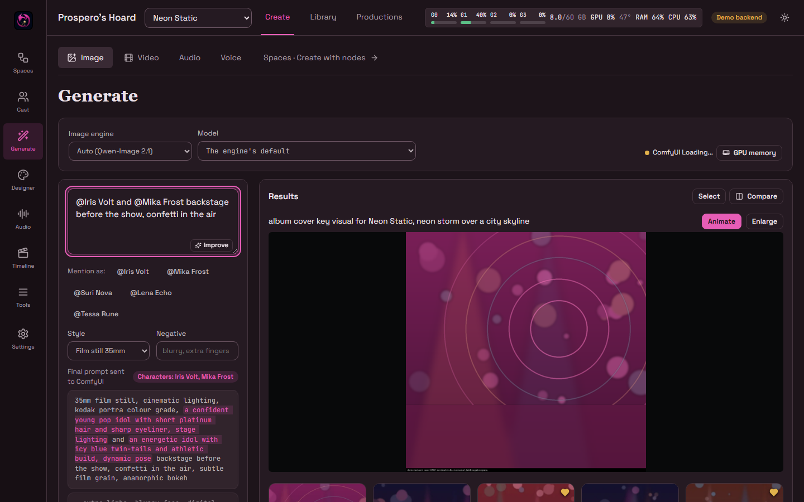
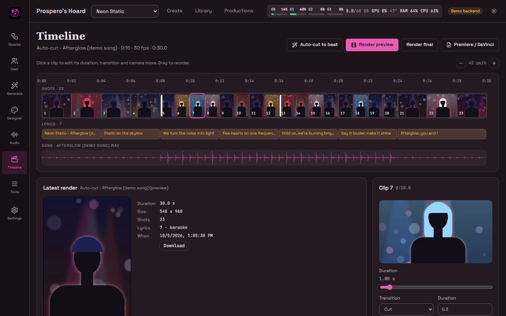
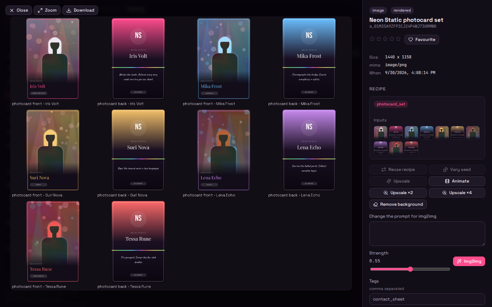
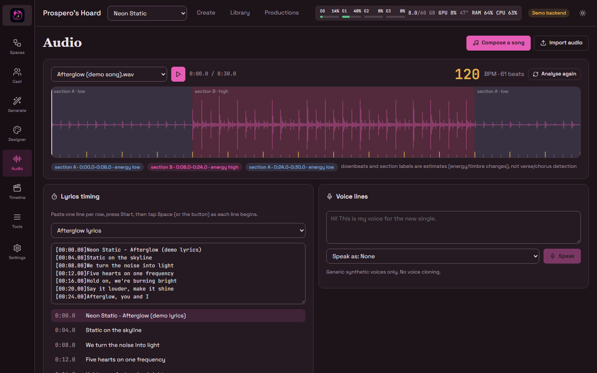
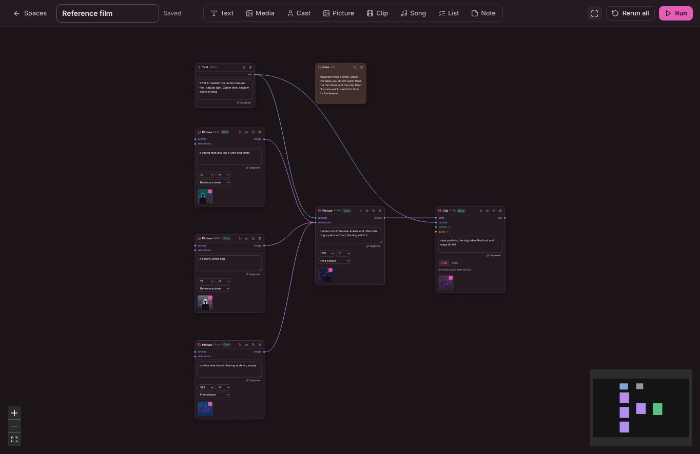
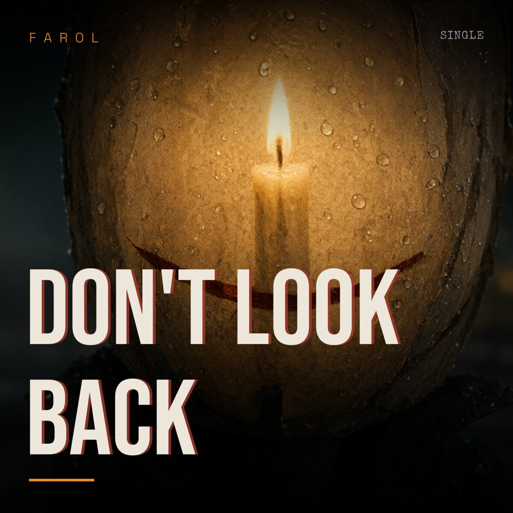
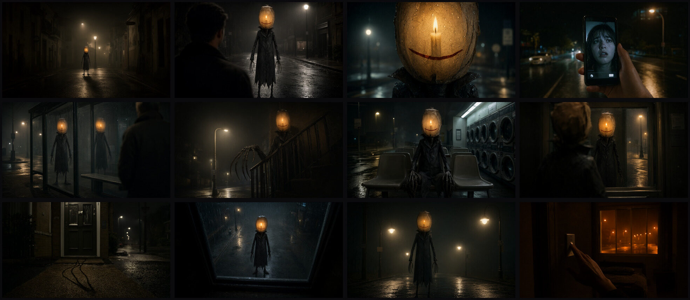
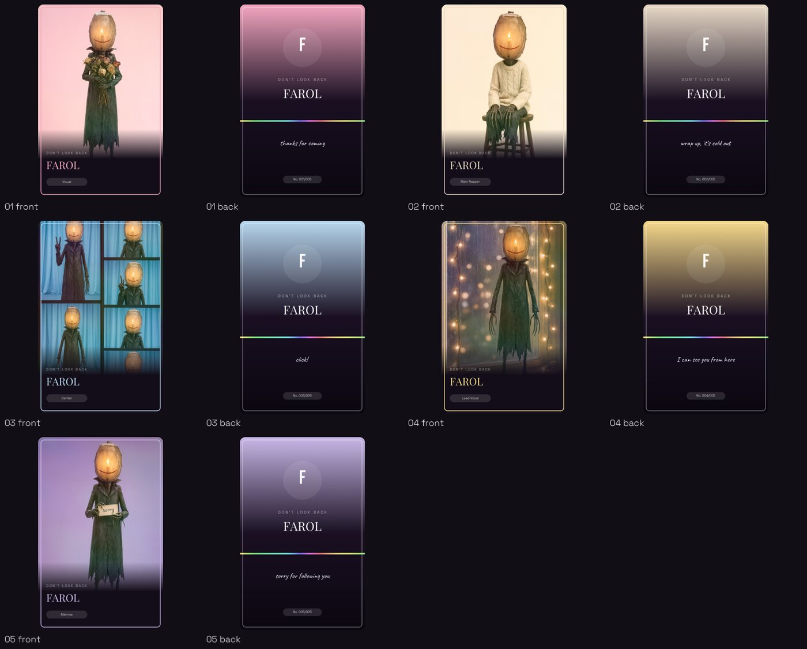
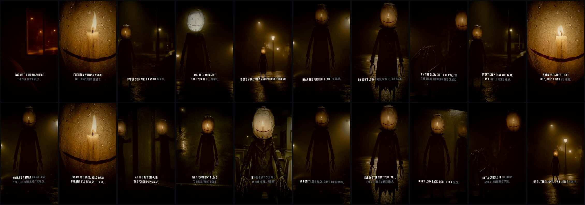
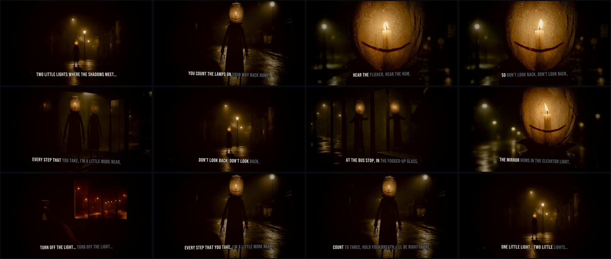

# Prospero's Hoard

A local media studio that drives your ComfyUI, ffmpeg and a local text-to-speech engine to make consistent characters, photocards, album art, music videos and narrated shorts, by hand or entirely over MCP.

[Español](README.es.md) · [Quick start](#quick-start) · [Connect to Faustus](#connect-it-to-faustus) · [MCP reference](docs/MCP.md) · [Voice studio](docs/VOICE.md)


*Actual application, synthetic demo data. Every picture comes from the bundled demo backend, a procedural stand-in for ComfyUI that draws labelled placeholder scenes; with your ComfyUI connected the same screens show real model output.*

## What it is

A language model asked to help with a small music production (an invented group, its photocards, a cover, a video for the single) can only describe what it would do. It cannot run a node graph, keep a character's face consistent across forty images, find the beat of a song, or later answer "which seed and checkpoint made this card?".

Prospero turns each step into a typed, queueable operation with a recorded recipe. Characters are mentioned as `@Name` and their description is inlined every time, every asset keeps the exact parameters that made it, songs are analysed for tempo and sections, and a timeline is cut on the beat and rendered with ffmpeg. The local model directs; the studio does the work and reports back with ids and pictures.

It is a FastAPI app with a React interface, a SQLite store and GPU and CPU job workers. It hosts no model of its own: image, video, music and speech backends are found through the family's shared resolver (ComfyUI, Faustus TTS, Piper). It is also a plugin for [Faustus](https://github.com/Luissalet/Faustus), with an MCP adapter that exposes the whole studio to an agent.

Typical uses:

- An independent musician imports a finished single, lets the beat tracker find tempo and sections, times the lyrics, and gets a cover, a lyric card and a 9:16 video cut on the beat.
- A writer or game designer gives each character a look prompt and a canonical reference, then asks for "@Iris and @Mika backstage" and gets the same faces across dozens of images.
- A local model in Faustus asked for "a teaser for the single" calls the studio tools, gets short ids back and looks at a picture only when it asks for one.
- Someone who explains things types a topic and gets a narrated vertical short: script, voice-over, word-by-word captions, stock or generated pictures and a music bed that ducks under the voice.
- A ComfyUI user imports their own UI-format workflow, gets it converted and checked against the live node list, and generates with it from then on with lineage.

## What it does

**Projects and cast**
- Receive production dossiers as drafts with the original context, approved references and details to preserve.
- Projects, characters (look prompt, negative, palette, canonical reference, voice), places and objects, ordered groups and style presets.
- `@Name` mentions match multi-word names and report unknown ones; a mentioned place or object with an image goes into the render as a numbered reference on Qwen-Image 2.1.
- Character kit: a model sheet redrawn from up to 12 set views, a captioned training dataset with a readiness report, local LoRA training through a configurable trainer, identity-scored takes, and portable `.hoardchar` packs plus a global casting library with versions.

**Images**
- Engines: Qwen-Image 2.1 (txt2img and multi-reference edit with 1-10 references), FLUX.1 schnell, FLUX.1 Kontext edits, SDXL (img2img, inpaint, two-pass hires fix) and SD 1.5. `auto` picks the best installed engine and every result says which one it used.
- Model upscale (x2 or x4), background removal to a transparent PNG, pose and depth maps, outpainting onto a larger canvas, reframing any picture or clip to 9:16, 16:9, 1:1, 4:5, 2:3, 3:2 or 21:9 without regenerating.
- Import your own ComfyUI workflows with preflight: node classes and model files are checked and missing ones are listed with the folder they belong in.

**Video**
- Image-to-video with Wan 2.2 (TI2V 5B, I2V 14B), SVD and LTX 2.3 (with optional 2x refinement and structure control); motion transfer, lip sync (speech and long singing), first-last-frame clips.
- Retake a stretch of a clip (Wan VACE), edit a whole clip from an instruction, smooth clips to a higher frame rate, review motion with technical checks and an optional vision model.
- Node canvases (Spaces) with typed, coloured connections for pictures, clips, songs, cast, layers and assistants, with undo and a docked node library.
- Graphic shots drawn by code (title card, kinetic lyrics, lower third, outro card), Manim scenes, HTML animations exported to H.264 with generated sound, QR films, promo videos from a web page, and website walkthrough recordings.
- Explanatory videos with scenes, narration and imported diagrams; image composition with object and text boxes.

**Audio and voice**
- Import of mp3, wav, flac, ogg and m4a, waveform, own beat tracker with downbeat and section estimates, LRC lyrics with timing tools, stem separation (vocals, drums, bass, other, instrumental).
- Song composition with ACE-Step 1.5 on ComfyUI, or another local server through a small HTTP API.
- Voice studio with a pluggable engine registry (Piper, Coqui XTTS-v2, F5-TTS, Kokoro, Chatterbox, KittenTTS, VoxCPM2, Yovoice, a ComfyUI TTS workflow), voice cloning from a sample you provide, speech-to-text, audiobooks, dubbing with timing plan and quality check, and word-level retakes of a voice line. See [docs/VOICE.md](docs/VOICE.md).

**Design**
- Pillow renderer without a browser: photocard fronts and backs, album covers (four layouts), teaser posters, lyric cards, tracklist backs and thumbnails, with a night variant, foil, gradients and shrink-to-fit text; photocard sets for a whole group or a solo artist.
- Style cards (look, technique, palette, motion, signature transition, pitfalls) with built-in and imported directions.

**Productions**
- Scene video from a dossier and character sheet, with anchored shots, first/middle/last continuity review, individual retakes and an assembled cut with per-shot provenance.
- A whole music video as one resumable, checkpointed production: lead and reference sheet, song, stills, lyric timing, clips, photocards, album art, the cut and its renders, plus a report. Changing shots redoes only what depends on them.
- Treatment-first mode (logline, structures, shot list, beat sheet) before anything renders; an animatic of the stills cut like the final before expensive clips; a QA director that checks flat or noisy stills, edge bands, exposure jumps, frozen clips and lyric coverage; a continuity bible with segment repair.
- Recipes: turn a finished production into a template with a `{lead}` slot and recreate it with another character.
- Narrated shorts from a topic or a script, with Pexels and Pixabay stock footage (free API key per provider) imported with its credit.
- Director: an idea becomes a narrated short film shot by shot. The language model writes the shot list (narration line, first frame, action, framing, camera move); the shared direction (genre, lens, light, film stock, look, grade, decade from 1960 to 2020) goes into every shot; 28 motion presets (camera, epic camera, effects, mood); one or more stills per shot, every shot animated with LTX 2.3 or Wan 2.2, optional clips that end on the next shot's still, a whoosh on every cut, subtitles from the voice and music. Each shot is edited on its own and only what changed is remade.

**Timeline and editing**
- Beat-synced auto-cut into an editable timeline, ffmpeg renderer with Ken Burns moves, transitions that keep cuts on the beat, lyric captions, colour grade and finishing effects, and a Spotify Canvas loop.
- Video enhancement of saved clips on a spare GPU (`media_enhance`, `clip_enhance`, `enhance_benchmark`): noise reduction, upscaling, sharpening, frame-rate interpolation and HDR10, with the cost per frame measured.
- Declarative edit plans compiled to exact ffmpeg steps, the timeline as stable text with revision-checked edits, and export to the video editor as FCP7 XML and EDL (Lumiere's Hoard opens it directly).
- Complete native timeline and subtitle editing modules and creative engines, each off until you enable it. See [docs/STUDIO.md](docs/STUDIO.md).

**Control and safety**
- Lineage: every asset records template, parameters, seed, inputs and timing; "Reuse recipe" reproduces an image byte for byte on the same backend and "Vary seed" re-runs it.
- GPU etiquette: VRAM estimates per workflow checked against the card ComfyUI runs on, jobs wait in `waiting_gpu` with the reason, render pools spread jobs over several cards, and the header shows GPU, VRAM, temperature, RAM and CPU.
- Trash with undo for deleted assets; Backends screen showing what was found and why; Assistant activity listing every call an agent made.

## Models

Nothing is bundled. Prospero uses whatever is installed in your ComfyUI and reports what is missing.

| Family | Used for |
| --- | --- |
| Qwen-Image 2.1 (int8) | Best prompt adherence, in-image text, multi-reference identity |
| FLUX.1 schnell / Kontext dev | Fast drafts / single-reference edits |
| SDXL, SD 1.5 | Always-available fallback, low-VRAM drafts |
| Wan 2.2 (TI2V 5B, I2V 14B, S2V, Animate, Fun VACE, Bernini-R), Wan 2.1 InfiniteTalk, SVD, LTX 2.3 | Image-to-video, lip sync, motion transfer, retakes, clip edits |
| ACE-Step 1.5 | Song composition with vocals |
| Real-ESRGAN x4, BiRefNet | Upscaling, background removal |
| SDPose whole body, Depth Anything 3 | Pose and depth maps |

Where each file goes (`models/<folder>` in ComfyUI) is shown by the workflow preflight and documented in [docs/ARCHITECTURE.md](docs/ARCHITECTURE.md). Heavy video models want a 16 GB card; a job that does not fit waits for one.

## Quick start

Requirements: Python 3.11+ (3.13 recommended), Node.js 22 for the interface, ffmpeg on PATH (the bundled `imageio-ffmpeg` binary is the fallback). ComfyUI is optional: `--demo` runs everything against a procedural stand-in.

```
git clone https://github.com/Luissalet/ProsperosHoard.git
cd ProsperosHoard
```

**Windows.** Double-click **`Iniciar Prospero's Hoard.cmd`** (or run `scripts\start.ps1`). The first run creates `.venv`, installs `requirements-lock.txt`, builds the interface and opens http://127.0.0.1:8815. **`Detener Prospero's Hoard.cmd`** stops it. Manual steps:

```powershell
C:\Python313\python.exe -m venv .venv
.venv\Scripts\python.exe -m pip install -r requirements-lock.txt
cd frontend; npm ci; npm run build; cd ..
.venv\Scripts\python.exe -m prosperos_hoard            # real data in .\data
.venv\Scripts\python.exe -m prosperos_hoard --demo     # demo data in .\data-demo
```

The Hub starts the MCP server from `.venv`, where the package is installed in editable mode (`.venv\Scripts\python.exe -m pip install -e . --no-deps`; `scripts\start.ps1` repeats it when missing), so the program an agent connects to is the code in this repository and cannot fall behind it.

**Linux / macOS.**

```bash
python3 -m venv .venv
.venv/bin/python -m pip install -r requirements-lock.txt
(cd frontend && npm ci && npm run build)
.venv/bin/python -m prosperos_hoard --demo --no-browser
```

Flags: `--port` (default 8815), `--data-dir` (or `PROSPERO_DATA_DIR`), `--demo`, `--no-browser`. `PROSPERO_ALLOWED_HOSTS` lets the API answer to a LAN or tailnet name. `curl http://127.0.0.1:8815/api/health` answers `"service": "prosperos-hoard"`.

`--demo` seeds an invented five-member group with portraits, stage shots, a cover, a photocard set, a synthetic 30 s song with timed lyrics and an auto-cut timeline. To use your ComfyUI, leave it on 127.0.0.1:8188 (Hoard Link finds it) or set its URL in Settings. `PROSPERO_COMFY_TIMEOUT_S` raises how long a job may run.

## Connect it to Faustus

Prospero's Hoard is a plugin for [Faustus](https://github.com/Luissalet/Faustus) and declares itself with [`faustus-plugin.json`](faustus-plugin.json). Start it, then in Faustus open **Connectors > Nearby apps > Add**: Faustus finds it on port 8815, reads the manifest and launches the MCP adapter (`prosperos_hoard/mcp_server.py`, stdio). The Faustus button inside the studio opens the shared copilot panel for the selected project; Faustus owns the conversation and the model, Prospero supplies its tools and context. Set the Faustus endpoint in `data/backend.json` or `PROSPERO_FAUSTUS_URL`.

### MCP tools

Results are compact and id-first; pictures come back only with `include_image=true`. Errors carry a code and a next step. Every call is audited under **Assistant activity**. Arguments and result shapes: [docs/MCP.md](docs/MCP.md).

| Group | Tools |
| --- | --- |
| Status and services | `studio_status`, `studio_services`, `studio_service_start`, `studio_service_stop`, `studio_gpu_memory` |
| Projects and cast | `studio_projects`, `studio_create_project`, `studio_project_update`, `studio_project_transfer`, `studio_modules`, `studio_cast`, `cast_import_character` |
| Images | `studio_generate_image`, `studio_edit_image`, `studio_outpaint`, `studio_reframe`, `studio_prompt_enhance`, `studio_cinema` |
| Video and clips | `studio_animate`, `studio_retake`, `studio_clip_edit`, `studio_interpolate`, `studio_review_clip`, `studio_spaces`, `studio_graphic_shot`, `studio_graphic_render`, `manim_*` |
| Audio and voice | `studio_compose`, `studio_analyze_audio`, `studio_stems`, `studio_voice`, `voice_*` (engines, create, list, speak, transcribe, audiobook, dub, retake words) |
| Design | `studio_design`, `studio_photocard_set`, `studio_board`, `studio_style_cards` |
| Timeline and render | `studio_timeline`, `studio_render`, `studio_export_timeline`, `studio_canvas`, `studio_style_profile_*`, `studio_production_finishing`, `production_export_lumiere` |
| Productions | `studio_production*`, `studio_scene*`, `studio_video_plan`, `studio_video_from_plan`, `studio_animatic`, `studio_qa_run`, `studio_qa_report`, `studio_recipe_*`, `production_from_storyboard`, `studio_short_create`, `studio_director`, `studio_director_catalog`, `studio_stock_search` |
| Character kit | `studio_character_sheet`, `_dataset`, `_train`, `_adapters`, `_takes`, `_pack`, `_library` |
| Web video | `brand_scan`, `promo_from_url`, `contact_sheet`, `website_walkthrough`, `studio_qr_video`, `studio_qr_verify`, `studio_explainer`, `studio_spatial` |
| Assets and jobs | `studio_assets`, `studio_show`, `studio_lineage`, `studio_asset_update`, `studio_import`, `studio_download_media`, `studio_delete_assets`, `studio_trash`, `studio_jobs`, `studio_job`, `studio_cancel_job`, `studio_retry_job` |

It works with any MCP client over stdio:

```json
{"mcpServers": {"prosperos-hoard": {
  "command": "C:/.../Prospero's Hoard/.venv/Scripts/python.exe",
  "args": ["C:/.../Prospero's Hoard/prosperos_hoard/mcp_server.py"],
  "env": {"PROSPERO_URL": "http://127.0.0.1:8815"}}}}
```

The end-to-end procedure an agent follows is in [skills/idol-production/SKILL.md](skills/idol-production/SKILL.md). The app also carries skills from the family library for agents that connect to it.

### The Hoard family

- **Shared agent contract.** `GET /api/agent/tools` lists every tool route and `POST /api/agent/call {name, arguments}` runs one with the family bearer token (`data/mcp-token`). Calls that change something must give a `reason`, are written to `data/agent_journal.jsonl` with agent and session, and a whole session can be undone with `POST /api/agent/undo` (dry run first).
- **Shared backends.** ComfyUI and TTS come from HoardLink; link downloads go through Links Hoard (yt-dlp as fallback), speech-to-text through Funes's Hoard when available. Nothing is loaded or unloaded behind your back.
- **Job events and notices.** Renders, songs, clips and productions emit `prospero.job.*` events; productions that need a take, the animatic or a review notify through the family hub (**Settings > Production notices**: `auto`, `hub` or `off`).
- **GPU lease.** GPU jobs hold the hub's lease for their class of model on top of the VRAM check (`PROSPERO_GPU_LEASE=0` turns it off).
- **Lumiere's Hoard.** **Export to Lumiere** on a production writes the cut as XML and EDL and asks Lumiere to open it as a project.

## Characters that stay the same

1. **Canonical**: one good image of the character.
2. **Model sheet**: the canonical redrawn from set views, each landing in the dataset with a caption.
3. **Dataset**: add the best takes, fix captions, watch the readiness report.
4. **Training**: pick the architecture of the engine you render with and start; the adapter is installed in ComfyUI and attached, so every `@Name` render loads it.
5. **Takes**: score identity, keep the good ones, reject drifted ones, promote a better canonical.
6. **Pack / library**: export a `.hoardchar` or save a version to the library and cast it into any project or use it as a recipe's lead.

Training runs a separate trainer program, configured under `training` in `data/backend.json` (`--demo` configures a fake one). Details: [docs/CHARACTERS.md](docs/CHARACTERS.md).

## Screens


*Actual application, synthetic demo data: the auto-cut of the 30 s demo song and the preview rendered with ffmpeg.*


*Actual application, synthetic demo data: the photocard set opened in the lightbox with its recipe and inputs.*


*Actual application, synthetic demo data: the demo song analysed by the built-in beat tracker, with section estimates and timed LRC lyrics.*


*Actual application, synthetic demo data: a space where three sheets feed a frame through its references and the frame starts a draft clip.*

<details>
<summary>A real production: an invented single, from cover to 9:16 and 16:9 cuts</summary>

The example single was composed with ACE-Step, cast with a consistent lead, and produced as a twelve-shot music video with Wan clips, a photocard set, a cover and two cuts.



<p>

</p>









</details>

## Privacy and security

Local only: the app binds 127.0.0.1, sends no telemetry and goes online only when you ask for a Piper voice that is not downloaded yet, for a link download or for stock footage. Requests with a foreign `Host` header are refused (DNS rebinding), and so are writes from other websites. Agents can import files only from your home folder, `data/inbox` and folders you add in Settings, and only files whose content matches their type; files are always served by id. Voice cloning runs on local engines you install explicitly and only from a sample you provide; using someone else's voice without consent is on you. Data stays in `data/` (or your `--data-dir`); the Faustus token is stored in `data/backend.json` and never returned by the API.

## Known limits

- The QA director's checks are heuristics; its bible, prompt and reference scores need a vision model, and picking the final take by ear is still yours.
- A recipe abstracts the lead's name, look and palette; shot prompts that describe the old lead's props are listed as warnings, not rewritten.
- Lyric auto-timing is an estimate from the song's structure; re-time by ear in **Audio > Lyrics timing** or import an aligned LRC. Section labels are "section A/B" with an energy level; very fast songs are reported at half time.
- Reproduction by recipe is guaranteed only on the same backend, models and ComfyUI version.
- Timeline editing is clip-level and colour grades are filter approximations, not 3D LUTs. Graphic shots use Pillow and the bundled fonts, without complex-script shaping.
- A short's script is written by whatever local model is found: check its facts before publishing. Nothing is uploaded to any platform.

## Project layout

| Path | Contents |
| --- | --- |
| `prosperos_hoard/` | Backend: API, job workers, ComfyUI driver, design, audio, timeline, video, voices, productions, recipes, MCP adapter, vendored `hoard_link`, native editing modules |
| `frontend/` | React studio interface |
| `editing_frontend/` | Editing client |
| `native/` | Incorporated native editing code |
| `skills/` | Procedures for connected agents |
| `docs/` | Architecture, API, MCP, voice, characters, studio, timeline text, style profiles and more |
| `scripts/` | Launchers, screenshot capture, asset build |
| `tests/`, `editing_tests/` | Test suites |
| `data/` | Your data (database, assets, settings, token); git-ignored |

Architecture and data model: [docs/ARCHITECTURE.md](docs/ARCHITECTURE.md). Every endpoint: [docs/API.md](docs/API.md).

## Development

```powershell
.venv\Scripts\python.exe -m pytest -q
.venv\Scripts\python.exe -m pytest editing_tests
cd frontend; npm ci; npm run build
```

On Linux/macOS use `.venv/bin/python`. The suite runs offline with no GPU and no model downloads: the demo backend stands in for ComfyUI and the voice tests use fake engines. CI runs on Ubuntu and Windows with Python 3.11 to 3.13 and builds the interface with Node.js 22.

## License

MIT, see [LICENSE](LICENSE). Bundled fonts keep their own licences: SIL Open Font License (`prosperos_hoard/fonts/*/OFL.txt`), except Special Elite (Apache License 2.0). Third-party notices are in [NOTICE](NOTICE).
